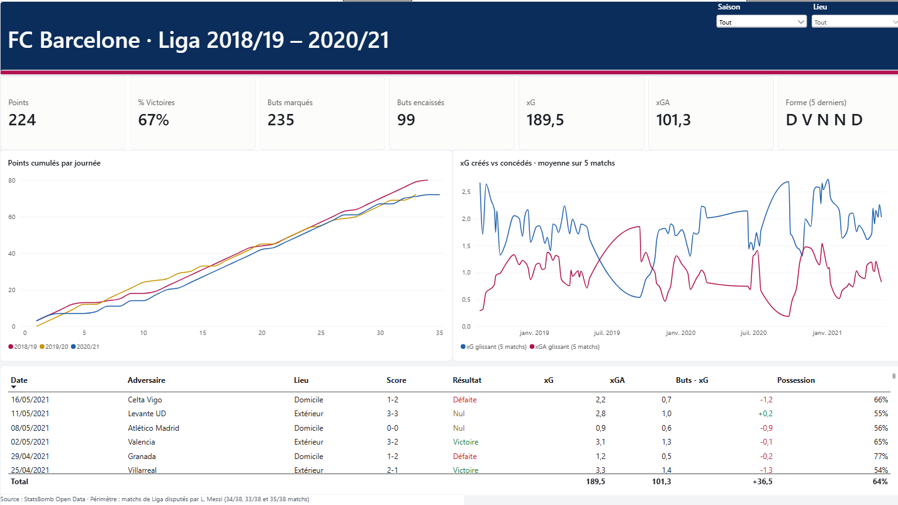
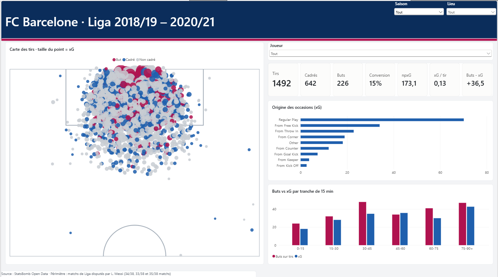
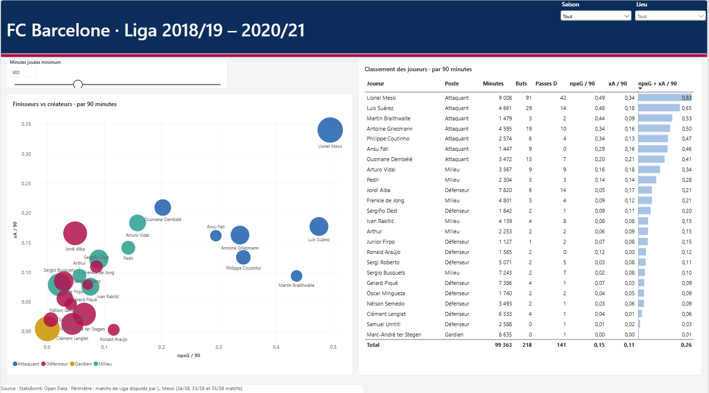
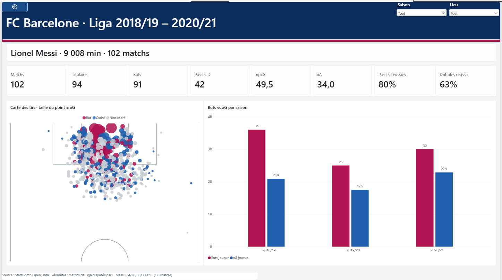
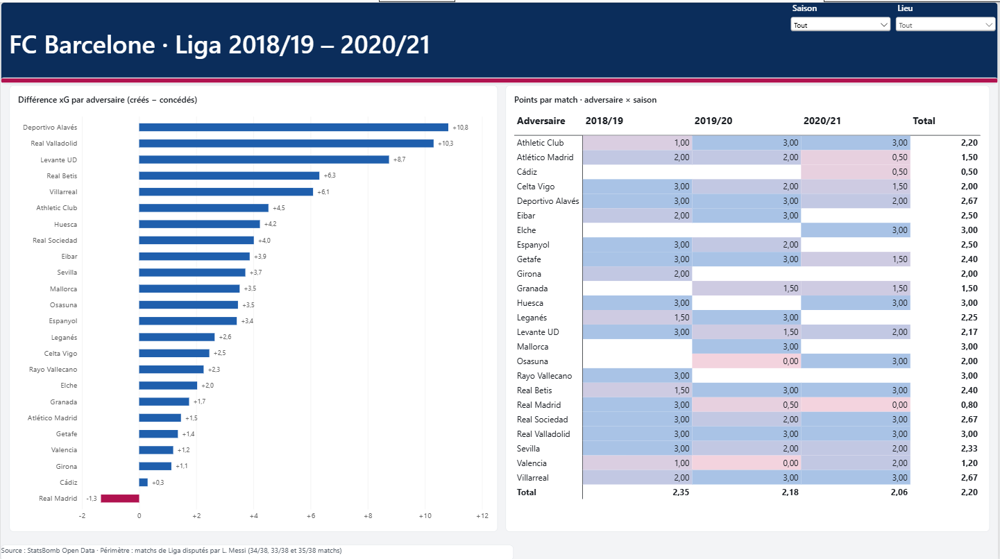
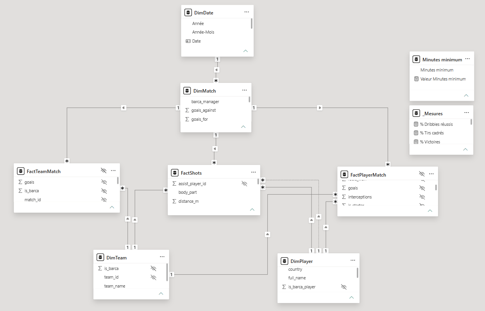

# ⚽ Barça Analytics — Power BI

Analyse de la performance du FC Barcelone en Liga sur trois saisons (2018/19 → 2020/21), à partir de **données événementielles réelles** (~400 000 événements : chaque passe, tir, dribble et pressing). Le projet couvre toute la chaîne : préparation des données en Python, modèle en étoile, environ 60 mesures DAX et un rapport Power BI de 5 pages orienté décision.



---

## 1. Questions métier

| Page | Question |
|---|---|
| **Vue d'ensemble** | La performance est-elle durable, ou portée par une finition exceptionnelle qui ne durera pas ? |
| **Attaque** | D'où et à quel moment du match l'équipe crée-t-elle le danger ? |
| **Joueurs** | Qui crée et qui finit, à temps de jeu comparable ? |
| **Fiche joueur** | Quel est le profil détaillé d'un joueur (accessible par clic droit → Extraire) ? |
| **Adversaires** | Contre qui l'équipe domine-t-elle, et contre qui souffre-t-elle ? |

## 2. Aperçu du rapport

| | |
|---|---|
|  |  |
| **Attaque** : carte des tirs sur terrain, origine des occasions, buts vs xG par tranche de 15 min | **Joueurs** : finisseurs vs créateurs (par 90 min), classement avec seuil de minutes paramétrable |
|  |  |
| **Fiche joueur** : page d'extraction (drillthrough) avec KPI, carte des tirs et évolution par saison | **Adversaires** : différence xG par adversaire et points par match adversaire × saison |

## 3. Enseignements clés

| Saison | Matchs | V-N-D | Points | Buts (sur tirs) | xG | Buts − xG | xGA |
|---|---|---|---|---|---|---|---|
| 2018/19 | 34 | 24-8-2 | 80 | 80 | 62,2 | **+17,8** | 34,9 |
| 2019/20 | 33 | 22-6-5 | 72 | 70 | 55,3 | +14,7 | 31,0 |
| 2020/21 | 35 | 22-6-7 | 72 | 76 | **72,0** | +4,0 | 35,4 |

- **2018/19 surperforme fortement ses xG** (+18 buts), porté par la finition de Messi (36 buts pour 20,9 xG).
- **2020/21 crée le plus d'occasions** (72 xG) mais les convertit le moins bien et compte le plus de défaites : le problème n'est pas la création, c'est la finition.
- **Le danger naît du jeu placé** (37 % des xG). Les séquences après coup franc pèsent 18 % des xG et ont donné **48 buts pour 34 xG**.
- **L'équipe finit fort** : la tranche 75-90+ est celle où elle crée (42,7 xG) et marque (47 buts) le plus.
- **Messi est seul dans le coin « élite »** : 0,49 npxG et 0,34 xA par 90 minutes. Suárez est un pur finisseur (0,48 / 0,18), Jordi Alba un défenseur créateur (0,05 / 0,17).
- **Le Barça a dominé 23 adversaires sur 24 aux xG.** Seule exception : le **Real Madrid** (−1,3 xG, 0,8 point par match).

## 4. Données

| Élément | Détail |
|---|---|
| Source | [StatsBomb Open Data](https://github.com/statsbomb/open-data) (licence libre, attribution requise) |
| Périmètre | FC Barcelone, Liga 2018/19, 2019/20, 2020/21 |
| Volume brut | 102 matchs, ~330 Mo de JSON, ~400 000 événements |
| Limite connue | StatsBomb ne publie que les matchs **joués par Lionel Messi** (34, 33 et 35 matchs sur 38). Les totaux sont donc inférieurs aux classements officiels. Cette limite est affichée sur chaque page du rapport. |

## 5. Architecture

```
StatsBomb JSON ──► Python (pandas) ──► CSV UTF-8 ──► Power Query ──► Modèle en étoile ──► Rapport 5 pages
  matches/            build_dataset.py      data/          typage            ~60 mesures DAX
  events/             make_pitch.py         assets/        culture en-US
  lineups/
```

Le script Python fait le travail lourd (agrégation de 400 000 événements) ; Power Query ne fait que typer. Le fichier Power BI reste léger et l'actualisation rapide.

**Transformations clés (`scripts/build_dataset.py`) :**
- minutes jouées reconstruites à partir des entrées et sorties de chaque joueur ;
- passes et courses **progressives** (rapprochent le ballon d'au moins 10 m du but adverse) ;
- **xA** : chaque tir est relié à la passe qui l'a amené ;
- possession calculée à partir de la durée des séquences de chaque équipe ;
- coordonnées des tirs converties pour une demi-surface verticale (carte des tirs) ;
- export **UTF-8 avec BOM**, pour des accents corrects (Piqué, Dembélé, Iñaki Peña).

## 6. Modèle de données



| Table | Granularité | Lignes |
|---|---|---|
| `FactShots` | 1 tir (deux équipes) | 2 478 |
| `FactPlayerMatch` | 1 joueur × 1 match | 2 969 |
| `FactTeamMatch` | 1 équipe × 1 match | 204 |
| `DimMatch` | 1 match du Barça | 102 |
| `DimPlayer` | 1 joueur | 655 |
| `DimTeam` | 1 équipe | 25 |
| `DimDate` | 1 jour (table calculée DAX) | 1 461 |
| `Minutes minimum` | paramètre déconnecté (0 → 3 000 min) | 34 |

- Relations **1 → plusieurs**, filtrage **unidirectionnel**.
- `FactShots[assist_player_id] → DimPlayer` : relation **inactive** (dimension de rôle passeur / tireur), activée via `USERELATIONSHIP`.
- `DimDate → DimMatch` : léger flocon assumé, car la date est un attribut du match.
- Colonnes techniques (ID) et tables de faits **masquées** : l'utilisateur ne manipule que les dimensions et les mesures.

## 7. Points techniques

- **Mesures d'équipe orientées Barça** via `KEEPFILTERS ( DimTeam[is_barca] = 1 )`.
- **Métriques par 90 minutes** (npxG/90, xA/90) pour comparer des joueurs au temps de jeu différent.
- **Paramètre déconnecté** (seuil de minutes) lu par `SELECTEDVALUE`, et mesure `Joueur éligible` utilisée comme filtre de visuel.
- **Intelligence temporelle « par match »** : points cumulés et moyennes glissantes sur 5 matchs (`TOPN`), plutôt que les fonctions calendaires classiques, inadaptées à un calendrier de matchs irrégulier.
- **Rang chronologique par saison** (`RANKX`) : les numéros de journée ne suivent pas la chronologie à cause des matchs reportés (en 2020/21, la J1 a été jouée en février 2021).
- **Page d'extraction** (drillthrough) vers la fiche joueur, avec bouton retour.
- **Mise en forme conditionnelle pilotée par mesures** : couleur du résultat, de Buts − xG et de la différence xG.
- **Segments synchronisés** sur les 5 pages ; carte des tirs avec image de terrain et axes calés sur les coordonnées StatsBomb.
- Pièges évités dans Power Query : encodage UTF-8 et culture `en-US` pour les décimales.

## 8. Contenu du dépôt

| Dossier / fichier | Contenu |
|---|---|
| `Barca_Analytics.pbix` | Le rapport Power BI |
| `data/` | Les 6 tables du modèle en CSV |
| `scripts/` | Pipeline Python (préparation des données, fond de terrain) |
| `powerbi/01_power_query.m` | Requêtes Power Query typées |
| `powerbi/02_mesures.dax` | Toutes les mesures DAX, commentées |
| `powerbi/03_tables_et_colonnes.dax` | Table de dates et colonnes calculées |
| `powerbi/05_mesures_tmdl.tmdl` | Mesures avec formats et dossiers, pour la vue TMDL |
| `powerbi/theme_barca.json` | Thème du rapport |
| `assets/` | Fond de terrain et captures d'écran |

## 9. Reproduire le projet

1. Ouvrir `Barca_Analytics.pbix` dans Power BI Desktop.
2. Si les données ne se chargent pas : **Transformer les données** > **Gérer les paramètres** > modifier `DossierDonnees` avec le chemin local du dossier `data\` (barre finale incluse), puis **Actualiser**.

Pour régénérer les CSV depuis les données brutes :

```bash
pip install pandas matplotlib
# télécharger les JSON StatsBomb : matches/11/{4,42,90}.json, puis events/ et lineups/ de chaque match
python scripts/build_dataset.py raw data
python scripts/make_pitch.py data assets
```

---

*Données : StatsBomb Open Data. Projet personnel réalisé à des fins de démonstration.*
